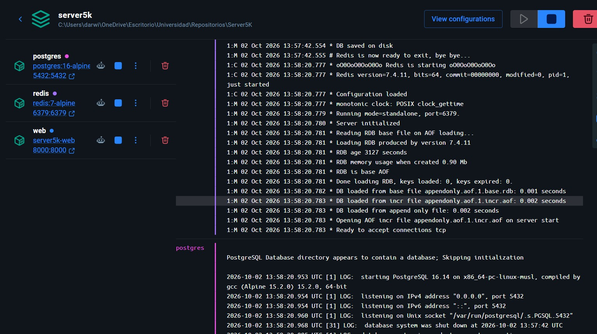
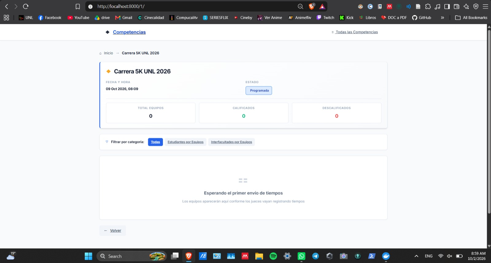
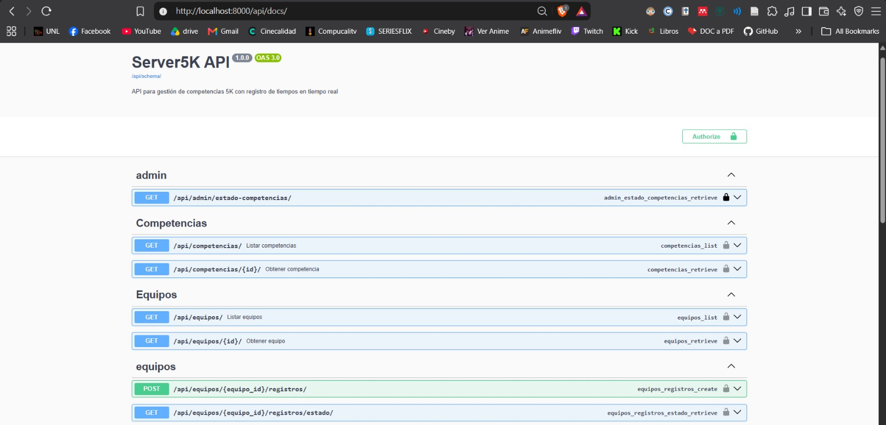

# Entorno y puesta en marcha

Fuente: [Reporte de los integrantes](../../../entregas/APE-01-reporte-publicacion.pdf), páginas físicas 3–5.

| Fuente | Entorno descrito | Alcance de la evidencia |
| --- | --- | --- |
| Reporte de los integrantes | Docker Compose: web, PostgreSQL 16 y Redis; Django 6.0 declarado. | Figuras 2–4: servicios, vista pública y Swagger. No implica que se haya repetido el despliegue al importar el documento. |
| Revisión técnica del portafolio | Django 5.2.8 instalado; SQLite temporal y Channels en memoria. | 19 comprobaciones reproducibles con jueces y equipos ficticios. |
| Demostración en Swagger | Servidor local enlazado a 127.0.0.1:8000 y base SQLite separada. | A06: respuesta 201 a tiempos negativos; A09: rechazo 401 y revisión del log. |

## Figuras aportadas en el documento

Las imágenes se extrajeron del PDF sin alterar su contenido. No contienen las credenciales de las cuentas de laboratorio ni prueban que todos los endpoints estén protegidos.

[Procedimiento de pruebas internas](../fase-04-owasp-y-priorizacion/evidencias/revision-server5k/README.md) · [Demostración en Swagger](../../../PRUEBAS-EN-SWAGGER.md)
