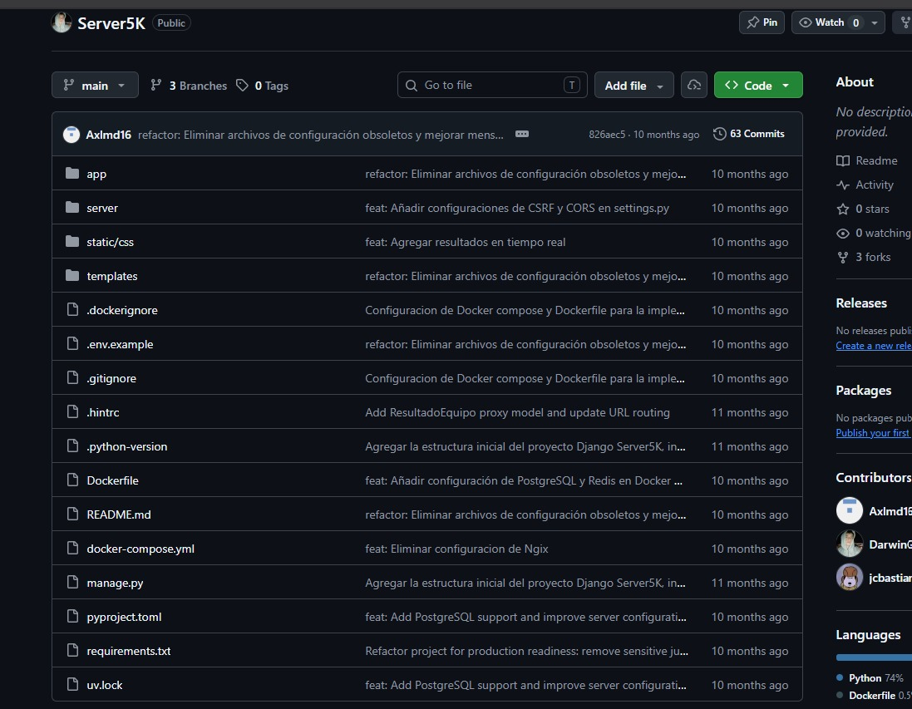

# Ficha del proyecto — avance de fase 1

Fuente: [Reporte de los integrantes](../../../entregas/APE-01-reporte-publicacion.pdf), páginas físicas 1–3. Adaptación a Markdown del documento entregado, con una precisión sobre las versiones verificadas.

| Campo | Descripción |
| --- | --- |
| Aplicación | Server5K — Sistema de competencias 5K |
| Función | Gestionar competencias, jueces, equipos y registros de tiempo en milisegundos, con actualización en tiempo real. |
| Integrantes | Darwin Enrique Granda Orosco; Darwin Andrés Sarango Soto; Joseph Sebastian Balcazar Loaiza. |
| Asignatura / ciclo / unidad | Software Security / 8A / Unidad 1. |
| Docente | Valeria Herrera Salazar. |
| Período de la práctica | 28 de septiembre al 23 de octubre de 2026. |
| Usuarios | Jueces autenticados, administrador y visitantes de la vista pública. |
| Backend | Django, Django REST Framework y Daphne/ASGI. El reporte declara Django 6.0; la revisión técnica local utilizó Django 5.2.8. |
| Tiempo real | Django Channels, WebSocket y Redis. |
| Persistencia | PostgreSQL 16 en el despliegue documentado; SQLite como alternativa local y base temporal de las pruebas aisladas. |
| Autenticación | JWT con SimpleJWT y modelo propio Juez. |
| Documentación | Swagger `/api/docs/` y ReDoc `/api/redoc/`. |
| Despliegue documentado | Docker Compose: web, PostgreSQL y Redis. |
| Código de la aplicación | https://github.com/DarwinG23/Server5K |
| Portafolio | https://github.com/josephsebal/Server5K-Seguridad |

## Roles

- Juez: consulta sus equipos y registra tiempos.
- Administrador: gestiona la aplicación desde Django Admin.
- Visitante: consulta competencias y resultados públicos.

## Selección de la aplicación

El documento identifica código disponible, autenticación y base de datos, y aporta capturas de servicios, interfaz y Swagger. Son evidencias proporcionadas por los integrantes; no describen una nueva ejecución realizada al preparar este avance. Las pruebas del portafolio deben mantenerse dentro del entorno propio o de laboratorio.

[Alcance](alcance.md) · [Inventario de 16 elementos](inventario-superficie.md) · [Entorno y capturas](entorno.md)
