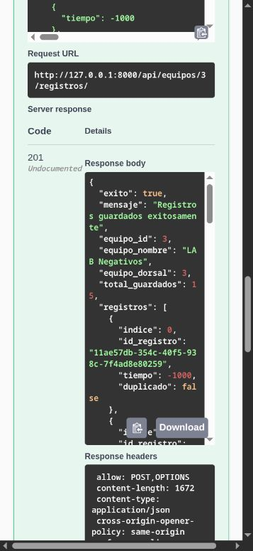
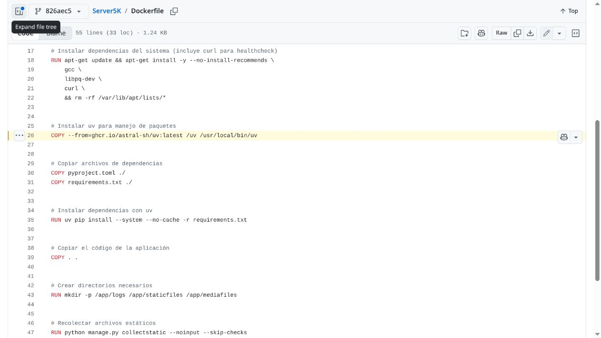
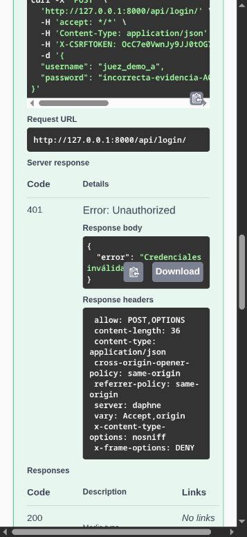

# Hallazgos explicados de forma sencilla

Fecha: 23/10/2026. Pruebas en laboratorio local separado, con cuentas y equipos ficticios.

| Categoría | Estado | Hallazgo sencillo | Evidencia: cómo se probó, resumido |
| --- | --- | --- | --- |
| A06: Insecure Design | Confirmado | La aplicación permite guardar tiempos negativos, aunque no son válidos para una carrera. | Desde Swagger, con un juez de prueba, se enviaron 15 tiempos de -1000 a POST /api/equipos/3/registros/. Respondió 201 e indicó que guardó los 15. Archivo: app/services/registro_service.py:265. |
| A08: Software or Data Integrity Failures | Observación de mejora; manipulación no demostrada | Al construir el sistema se usa uv:latest: una versión que puede cambiar sin que cambie el proyecto. No se fija una imagen exacta mediante su digest. | Se revisó Dockerfile:26 en el mismo commit auditado. La captura muestra la instrucción COPY con uv:latest. No se modificó una descarga ni se probó un instalador, porque no se identificó ese módulo propio. Esta observación también se relaciona con A03. |
| A09: Security Logging and Alerting Failures | Registro de autenticación incompleto | Cuando falla un login, el log indica que hubo un rechazo, pero no identifica la cuenta intentada ni su origen. Esto dificulta investigar intentos sospechosos. | Desde Swagger se envió una contraseña incorrecta para juez_demo_a a POST /api/login/. Respondió 401. Se revisó el django.log del laboratorio: contiene la hora y Unauthorized: /api/login/, sin cuenta ni IP. También se revisó app/views/auth_views.py, donde no se emite un evento de login con esos datos. |

## Capturas

Se conserva una captura por caso: la de A06 ya existía; se añadieron solamente las pendientes de A08 y A09.

### A06 — Tiempo negativo aceptado

### A08 — Referencia de herramienta sin digest fijo

Se muestra el [Dockerfile del commit auditado](https://github.com/DarwinG23/Server5K/blob/826aec5c04dfc5d3f8be77e9abde2d13f69a51e8/Dockerfile#L26), correspondiente al archivo local revisado. La captura prueba una configuración movible, no una intrusión ni una descarga alterada.

### A09 — Intento de login rechazado

La captura demuestra que se provocó el rechazo. La conclusión sobre el registro se apoya además en el [log real del laboratorio](evidencias/revision-server5k/EVI-A09-log-login-rechazado.txt) y la revisión del código, no únicamente en el 401. La línea observada registra hora y ruta, por lo que no se afirma ausencia total de logs. No se evaluó monitoreo externo ni se demuestra la ausencia de todas las alertas de un despliegue real.

## No confundir los resultados

- A06: se confirmó que los tiempos negativos son aceptados por la API del laboratorio.
- A08: se observó una mejora de integridad de la construcción. La simulación de un actualizador no aplica al módulo identificado; no se declara que toda la categoría esté libre de riesgos.
- A09: se observó un registro incompleto. Un error 401 es correcto para una contraseña equivocada; el problema es el contexto que falta en el log de ese intento.
