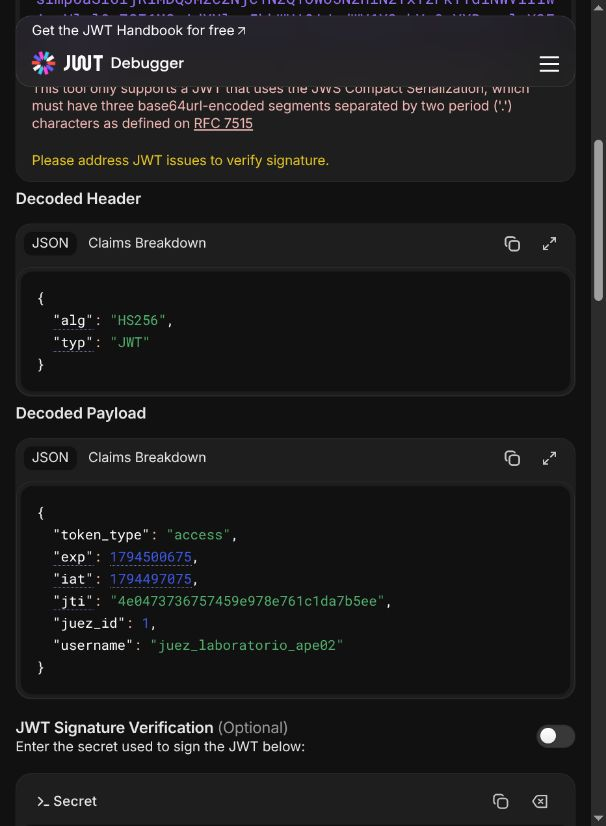

# Fase 2 · Sesión 1: Análisis de tokens de sesión

Jueves 12 de noviembre de 2026 · 09h30 a 11h30

### **Actividad 1\. Repaso de JWT e IDOR**

Un token JWT funciona como una credencial de sesión. Tiene tres partes: la cabecera indica cómo se firma; el contenido (payload) guarda datos del usuario y de la sesión, llamados claims; y la firma permite comprobar que esos datos no fueron modificados. Decodificar significa leer el contenido del token. Para confiar en él, también es necesario verificar su firma.

El campo alg indica el algoritmo de firma. Si aparece alg: none, significa que el token no tiene firma. Aceptarlo para iniciar una sesión permitiría confiar en datos que alguien pudo modificar. Además, un token sin fecha de vencimiento podría seguir utilizándose después de ser robado. IDOR es otro problema: ocurre cuando un usuario accede a información ajena porque el servidor no comprueba sus permisos. En esta sesión revisamos el concepto; las pruebas de IDOR corresponden a la sesión 2\.

### **Actividad 2\. Laboratorio de análisis de tokens**

Analizamos la versión 826aec5c de Server5K en un entorno local de prueba. Usamos una cuenta ficticia, una base de datos temporal y una clave de firma creada para el laboratorio. Las solicitudes se realizaron con APIClient, la herramienta de pruebas de Django, que ejecuta el código real de la aplicación. El entorno utilizó Django 5.2.8, SimpleJWT 5.5.1 y PyJWT 2.10.1.

Obtención del token. El 12 de noviembre, a las 10:24:35, iniciamos sesión mediante POST /api/login/ con la cuenta juez\_laboratorio\_ape02. La aplicación respondió con el código 200, que indica una solicitud exitosa, y entregó dos tokens: uno de acceso (access), para utilizar la API, y otro de renovación (refresh), para obtener nuevos tokens de acceso sin volver a escribir la contraseña.

| Campo | Valor observado | Interpretación |
| :---- | :---- | :---- |
| alg / typ | HS256 / JWT | Firma verificada con una clave secreta. |
| token\_type | access | Token para acceder a la API. |
| juez\_id / username | 1 / juez\_laboratorio\_ape02 | Identidad de la cuenta ficticia. |
| iat | 1794497075 | Fecha y hora de creación (iat). |
| exp | 1794500675 | Fecha y hora de vencimiento (exp). |
| jti | 4e0473736757459e978e761c1da7b5ee | Código que identifica este token (jti). |
| Otros datos | No incluye iss, aud, sub, user\_id, nbf ni roles. | El login personalizado usa juez\_id; no expone contraseña. |

### **Evidencias del análisis del token**

Lectura del token en jwt.io. La siguiente captura muestra la cabecera y el contenido del token de acceso. Para esta captura retiramos la firma de una copia del token; por eso la página muestra una advertencia. La firma del token original sí se verificó en el entorno local, sin compartir la clave con el sitio.

*Figura 1\. Decodificación real del token de la cuenta ficticia. La firma se omitió únicamente en la copia utilizada para esta captura.*

Duración del token de acceso. Se creó el 12 de noviembre de 2026 a las 10:24:35 y vence ese mismo día a las 11:24:35, en horario de Ecuador. Por tanto, dura 60 minutos. Obtuvimos estas fechas de los campos iat (momento de creación) y exp (momento de vencimiento), cuyos valores numéricos aparecen en la tabla anterior.

Duración del token de renovación. Se creó el 12 de noviembre de 2026 a las 10:24:35 y vence el 19 de noviembre a la misma hora: dura 7 días. Pertenece al mismo usuario, pero tiene un identificador propio (jti) y se distingue por el campo token\_type, cuyo valor es refresh. Ambos tokens usan HS256, un método que permite verificar la firma con una clave secreta.

### **Actividad 3\. Registro de hallazgos**

Verificación en el servidor. Primero comprobamos que la firma del token original era válida. Después enviamos ese token y cuatro versiones modificadas a /api/me/, la ruta que devuelve los datos del usuario autenticado. En los casos de token vencido y token sin vencimiento mantuvimos una firma válida para comprobar específicamente el control de expiración. El código 200 indica que la solicitud fue aceptada; el 401, que fue rechazada por un problema de autenticación.

| Prueba sobre /api/me/ | HTTP | Resultado observado |
| :---- | :---- | :---- |
| Token de acceso original | 200 | Devuelve la cuenta ficticia. |
| Token sin firma (alg: none) | 401 | Rechazado: el token no es válido. |
| Contenido alterado, sin actualizar la firma | 401 | Rechazado: el token no es válido. |
| Token con fecha de vencimiento pasada | 401 | Rechazado: el token está vencido. |
| Token sin fecha de vencimiento (sin exp) | 401 | Rechazado: falta la fecha de vencimiento. |

Registramos los resultados del análisis y la revisión de la configuración en el siguiente reporte de control de acceso:

| Hallazgo / evidencia | Riesgo o valoración | Corrección / criterio |
| :---- | :---- | :---- |
| 1\. La firma y el vencimiento se verifican correctamente. | Control satisfactorio en las pruebas: el token original funciona y las cuatro variantes se rechazan. | Mantener la comprobación de firma y vencimiento, y aceptar solo el algoritmo configurado. |
| 2\. El código incluye una clave fija que se usa si falta SECRET\_KEY (settings.py, líneas 13 y 210). | Riesgo alto si el servidor usa esa clave conocida: alguien podría crear tokens falsos con firmas válidas. Encontramos la clave de respaldo en el código, pero no comprobamos si el servidor publicado la utiliza. | Exigir una clave secreta propia y no permitir el inicio del servidor si falta. Si la clave se expuso, reemplazarla e invalidar las sesiones afectadas. |
| 3\. El token de acceso dura 60 minutos y el de renovación, 7 días. | Ambos vencen. Si alguien los obtiene, podría utilizarlos durante su tiempo de validez, siempre que los demás controles lo permitan. Su duración, por sí sola, no demuestra una vulnerabilidad. | Evaluar si la aplicación necesita reducir el tiempo de validez del token de acceso. |

Concluimos que Server5K emite tokens con vencimiento y, en las pruebas realizadas, rechazó los tokens sin firma, modificados, vencidos y sin fecha de expiración. La mejora principal es eliminar la clave fija que el código usa cuando no se configura una clave propia. Estas conclusiones se limitan al entorno local; no evaluamos el servidor publicado ni realizamos pruebas de IDOR.

Archivos de respaldo. resultados.json contiene los valores del token y las respuestas de las pruebas; analizar\_jwt.py permite repetir el laboratorio; E02-jwtio.png conserva la captura. Revisamos app/views/auth\_views.py (líneas 90–98), server/settings.py (líneas 13 y 203–220) y app/auth/authentication.py.
