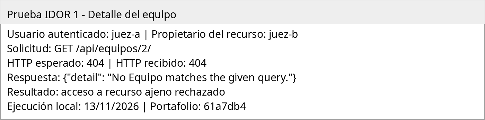
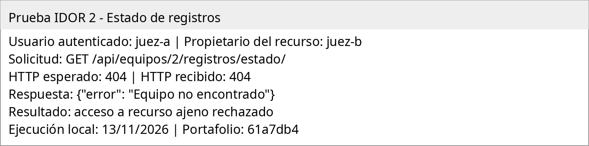
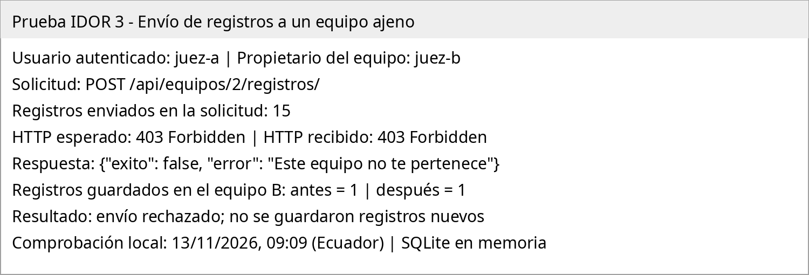

# APE 02 · Fase 2 · Sesión 2: pruebas IDOR y correcciones

Sesión del **13/11/2026**. Publicación: **18/11/2026**.

Completamos el reporte de control de acceso con tres pruebas IDOR, la comprobación de roles y la validación de tokens. Utilizamos cuentas ficticias y una base SQLite aislada. Los resultados describen el entorno local; no verifican el servidor de producción.

## Actividad 1. Controles recomendados

- **Autorización por objeto:** `EquipoViewSet.get_queryset()` filtra los equipos por el juez autenticado. `EstadoEquipoRegistrosView` busca el equipo por su identificador y por `judge_id`. `RegistrarTiemposView` compara el propietario antes de guardar registros.
- **Expiración:** el token de acceso dura 60 minutos y el de renovación, 7 días. La duración limita la sesión, pero por sí sola no demuestra una vulnerabilidad.
- **Firma:** `JuezJWTAuthentication` utiliza la validación de SimpleJWT. El algoritmo configurado es HS256. Los tokens alterados o vencidos deben rechazarse en el servidor.

Código: [equipos](../../../../Server5K/app/views/equipo_views.py), [registros](../../../../Server5K/app/views/registro_views.py), [autenticación](../../../../Server5K/app/auth/authentication.py) y [configuración](../../../../Server5K/server/settings.py).

## Actividad 2. Laboratorio IDOR

Creamos dos jueces, A y B, con un equipo cada uno. El equipo B tenía un registro de tiempo. Autenticamos al juez A e intentamos acceder al equipo B cambiando el identificador de la URL.

| Prueba | Solicitud | Respuesta obtenida | Interpretación |
| --- | --- | --- | --- |
| Consulta del equipo ajeno | `GET /api/equipos/2/` | 404 | El filtro del juez impide consultar el equipo B. |
| Consulta del estado de registros ajenos | `GET /api/equipos/2/registros/estado/` | 404 | La búsqueda exige que el equipo pertenezca al juez autenticado. |
| Envío de registros ajenos | `POST /api/equipos/2/registros/` con 15 registros | 403 | La autorización rechaza la escritura antes de guardar. El equipo B conserva 1 registro antes y después. |

### Evidencias







Estas imágenes presentan los resultados de comprobaciones locales del 13/11/2026. El [registro JSON](evidencias/resultados-2026-11-13.json) conserva solicitudes, respuestas y conteos, sin contraseñas ni tokens. No son capturas de una herramienta de terceros.

## Actividad 3. Cierre del reporte

| Verificación | Resultado |
| --- | --- |
| Juez común en `/api/admin/estado-competencias/` | 403 Forbidden |
| Administrador con sesión autenticada en el mismo endpoint | 200 OK |
| Token alterado en `/api/me/` | 401 Unauthorized |
| Token expirado en `/api/me/` | 401 Unauthorized |

El código ya contenía las correcciones y siete pruebas en [AuthorizationSecurityTests](../../../../Server5K/app/tests/tests.py). En esta actualización no modificamos la aplicación: incorporamos la documentación y volvimos a ejecutar esa clase. El [registro de ejecución del 18/11/2026](evidencias/verificacion-2026-11-18.txt) corresponde a esas siete pruebas, no a toda la aplicación.

### Hallazgos, riesgos y controles

| Situación evaluada | Riesgo | Control y resultado local |
| --- | --- | --- |
| Identificador de otro equipo en la URL | Lectura de información ajena | Filtrar por propietario; ambas consultas respondieron 404. |
| Envío de tiempos a otro equipo | Modificación de registros ajenos | Comprobar propietario antes de escribir; respuesta 403 y conteo sin cambios. |
| Usuario común en endpoint administrativo | Acceso a funciones reservadas | Verificar el rol en servidor; juez 403 y administrador 200. |
| Token alterado o vencido | Acceso con credencial inválida | Validar firma y expiración; respuesta 401. |

No se observó un acceso indebido en estos casos. Se deben conservar los controles y ampliar las pruebas al agregar endpoints. La evidencia usa A contra recursos de B; no acredita una repetición inversa B contra A ni cobertura de todos los recursos. La clave de respaldo señalada en la sesión 1 sigue siendo una observación independiente: estas pruebas no acreditan su eliminación en producción.

## Reproducción

Desde la raíz del repositorio, con un Python que tenga las dependencias de Server5K instaladas:

```bash
python guias/ape-02/fase-02-control-acceso/sesion-02-idor/verificar.py
```

El script utiliza SQLite en memoria y una clave efímera. Las pruebas crean sus propios usuarios y recursos; no utilizan la base real.

## Procedencia

Contenido contrastado con `APE_02_ Fase 02_ Control de acceso y autenticación_Seccion2.docx.pdf`, entregado el 18/11/2026, y con el código del portafolio en `61a7db4`. Se incorpora la sesión 2 sin declarar terminadas las fases 3 y 4. La interfaz Swagger mencionada en el PDF no se volvió a comprobar en esta ejecución.

[Sesión 1: análisis JWT](../sesion-01-jwt/README.md) · [Índice APE 02](../../README.md)
